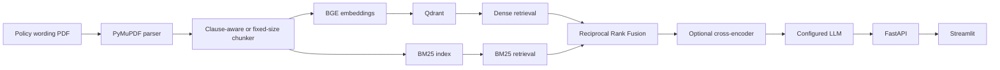

# PolicyLens

PolicyLens is a Python application for exploring Indian health-insurance policy wording. It parses PDFs, indexes clause-aware chunks in Qdrant and BM25, and exposes retrieval and analysis through FastAPI and Streamlit.

The project is under active evaluation. Claims in this README describe implemented code; they do not imply that a policy has been indexed, an answer is accurate, or an external service is connected. See [RESULTS.md](RESULTS.md) and [PROJECT_PROGRESS.md](PROJECT_PROGRESS.md) for verified status.

## Architecture and data flow



- The parser extracts selectable text and PyMuPDF tables. It records clause identifiers, sections, UIN when detected, and page spans. Scanned PDFs without useful text are not OCR-processed.
- The clause-aware chunker preserves clause and table context; the fixed-size chunker is available as an evaluation baseline.
- Qdrant stores vectors and payloads. BM25 indexes clause text. Hybrid retrieval combines both lists with RRF. A sentence-transformers cross-encoder can rerank the candidate pool when `RERANKER_ENABLED=true`; if its model cannot load, a warning is logged and RRF order is returned.
- The application currently implements the Gemini API and an explicit mock provider. Configuring an unsupported provider fails visibly; it does not silently select the mock.
- Policy metadata and serialized BM25 indexes are stored under `QDRANT_LOCAL_PATH`. Re-ingestion and deletion have rollback handling across the vector points and local metadata files.

## Installation and configuration

Python 3.11 or newer is required.

```powershell
python -m venv .venv
.venv\Scripts\Activate.ps1
python -m pip install -e ".[dev]"
Copy-Item .env.example .env
```

Set `LLM_PROVIDER=gemini` and `GEMINI_API_KEY` for live generation. For explicit offline API development, use `LLM_PROVIDER=mock`; mock outputs are not evaluation evidence. The BGE embedding model is downloaded by `sentence-transformers` on first use unless it is already cached.

Relevant settings include `EMBEDDING_MODEL`, `EMBEDDING_DEVICE`, `RERANKER_MODEL`, `RERANKER_ENABLED`, `RERANKER_CANDIDATE_POOL`, `QDRANT_MODE`, `QDRANT_LOCAL_PATH`, `QDRANT_HOST`, and `QDRANT_PORT`. Never commit `.env` or credentials.

## Official policy acquisition

`data/policies.csv` is the manifest. It records product, UIN, source URL, local path, date, page count, hash, and validation status. The current manifest has six policy entries with insurer-hosted or insurer-linked wording URLs. Direct downloads are subject to network access and each resulting PDF must pass content, UIN, page-count, and text checks.

```powershell
.venv\Scripts\python.exe -m data.acquire_policies
```

The command retries transient errors, follows HTTPS redirects, checks that the final host is approved for the insurer, validates the PDF, hashes it, and writes `data/acquisition_report.json`. It skips valid files, does not replace a different version without `--refresh`, and distinguishes a local PDF whose source provenance is unknown. PDFs downloaded into `data/raw/` are ignored by Git; keep the manifest and report with the project.

## Ingestion and indexing

Ingest a single validated wording:

```powershell
.venv\Scripts\python.exe -m app.cli ingest data/raw/care_supreme.pdf --policy-id care-supreme --insurer "Care Health Insurance Limited"
.venv\Scripts\python.exe -m app.cli list-policies
```

Ingest manifest entries whose validation status is `valid` or `valid_uin_not_detected`:

```powershell
.venv\Scripts\python.exe -m data.ingest_policies
```

Local PDFs with unverified source provenance require the explicit `--include-unverified-local` option. Successful ingestion writes a per-policy report under `data/ingestion_reports/` with page count, selectable text, clause and chunk counts, warnings, and vector cleanup. Low parser counts are flagged for review. Repeated ingestion replaces stale chunks for that policy; deletion removes its Qdrant points, BM25 file, and registry entry.

## Retrieval, API, and UI

```powershell
.venv\Scripts\python.exe -m uvicorn app.main:app --reload --port 8000
.venv\Scripts\python.exe -m streamlit run ui/app.py
```

FastAPI docs are at `http://localhost:8000/docs`. Routes include policy ingestion/list/deletion, Q&A, summaries, red-flag analysis, and policy comparison. The Q&A schema supports clause/page/quote citations and abstention. Red flags and comparison points include supporting wording when the source clause is retrieved. Summary fields still lack field-level citations and should be treated as unverified structured extraction.

For reranking, enable it with `RERANKER_ENABLED=true`. Set `false` to use RRF output only. An unavailable model triggers an observable fallback; the API continues with RRF.

## Evaluation

Validate the manually labeled data and source references:

```powershell
.venv\Scripts\python.exe -m eval.validate_eval_data
```

Run the retrieval and chunking ablation on the same policy, labels, and corpus:

```powershell
.venv\Scripts\python.exe -m eval.run_retrieval_ablation --policy-id icici-complete-health --pdf data/icici_complete_health.pdf --reranker
```

This evaluates BM25-only, dense-only, hybrid RRF, and hybrid with a cross-encoder across clause-aware and fixed-size chunks. The cross-encoder configuration may report an explicit RRF fallback if the model is unavailable. `--mock-embeddings` is for diagnostic runs only and must not be used to claim retrieval quality.

The QA dataset schema is documented in [eval/README.md](eval/README.md). Extraction scoring accepts a predictions JSON file:

```powershell
.venv\Scripts\python.exe -m eval.score_extraction --predictions path\to\predictions.json --out eval/results/extraction.json
```

RAGAS is optional (`pip install -e ".[eval]"`). `eval/run_ragas.py` requires a validated corpus, the app's real provider configuration, and `OPENAI_API_KEY` for the default RAGAS judge. It reports dependency/key/provider errors instead of inventing metrics. RAGAS has not been run on this checkout.

## Tests

```powershell
.venv\Scripts\python.exe -m pytest tests/ -q -p no:cacheprovider --basetemp=E:\Insurance\pytest-temp
```

The workspace temp path avoids the restricted host temp directory in this environment.

## Docker

```powershell
docker compose up --build
```

Compose defines persistent Qdrant data and a separate volume for API-side BM25/registry metadata, plus Qdrant and API health checks. Docker was not available in the evaluation environment, so the build, startup, health checks, and ingestion flow are unverified. Set `GEMINI_API_KEY` in the environment before starting the default Gemini configuration.

## Langfuse

The repository has Langfuse settings and Compose environment passthrough, but there is no tracing call in the active retrieval/generation path. Tracing is not implemented or verified; setting credentials alone does not produce traces.

## Current limitations

- Only one local policy PDF has been content-validated in this environment. Its title and UIN match an official ICICI Lombard wording source, but its acquisition provenance has not been verified against downloaded bytes.
- Other insurer PDFs could not be downloaded because outbound sockets are blocked. No policy in the manifest is claimed as successfully downloaded unless its report says so.
- The manually checked QA set has 33 questions across five officially validated policy wordings and one local source-unverified wording. Its PDF page references pass validation. This small set is not evidence of general answer accuracy.
- Extraction labels contain 7 manually referenced verified fields for one policy; predicted extraction accuracy has not been measured.
- OCR is not included. RAGAS, live Gemini quality, Docker, and Langfuse remain unverified.
- `eval/compare_cases.jsonl` and older parser/chunking result artifacts are synthetic or unvalidated and must not be presented as real-policy evaluation.
- PolicyLens is informational only and is not insurance, legal, or financial advice.
