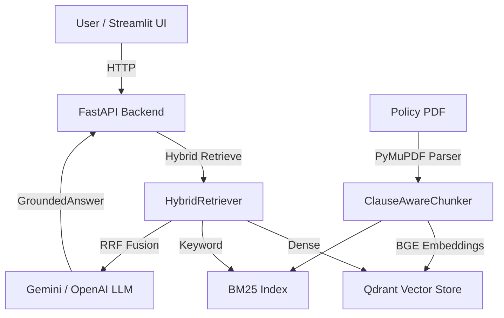

# PolicyLens 🔍

> **AI-Powered Indian Health Insurance Policy Analyser**
> Grounded RAG system with citation-level evidence for every answer.

[](https://github.com/your-org/policylens/actions/workflows/ci.yml)
[](https://www.python.org/downloads/)
[](https://fastapi.tiangolo.com)
[](https://qdrant.tech)

---

## What is PolicyLens?

PolicyLens is a **production-grade Retrieval-Augmented Generation (RAG)** application for Indian retail health insurance policies. It answers buyer questions grounded in the exact wording of a policy document, never hallucinating.

### Features

| Feature | Description |
|---|---|
| **📤 PDF Ingestion** | Upload any policy PDF — auto-parsed, chunked by clause, and indexed |
| **💬 Grounded Q&A** | Answers with `clause_id + page + verbatim quote` citations, or abstains |
| **📋 Summary Card** | Auto-extracts waiting periods, room rent, co-pay, exclusions, claim process |
| **🚩 Red Flag Scanner** | Finds buyer-unfriendly clauses with severity ratings |
| **⚖️ Policy Comparison** | Side-by-side scenario comparison (e.g. knee replacement, maternity) with citations |

---

## Architecture



### Key Design Decisions

| Decision | Choice | Rationale |
|---|---|---|
| PDF Parsing | PyMuPDF | Best table extraction, free, fast (see ADR 001) |
| Chunking | Clause-Aware | Preserves legal clause boundaries; superior to fixed-size |
| Embeddings | BAAI/bge-base-en-v1.5 | Strong retrieval performance, 768-dim, Apache 2.0 |
| Retrieval | Dense + BM25 → RRF | Hybrid catches both semantic and exact-match queries |
| LLM | Gemini 1.5 Flash | Structured JSON output, citation-or-abstain enforcement |
| Storage | Qdrant Local | No Docker needed for dev; swap to server mode for prod |

---

## Project Structure

```
policylens/
├── app/
│   ├── core/           # Config, schemas, LLM abstraction, logging
│   ├── ingestion/      # PyMuPDF parser, table extraction, clause classification
│   ├── indexing/       # BGE embeddings, Qdrant vector store, BM25 index, chunker
│   ├── retrieval/      # HybridRetriever, Reciprocal Rank Fusion
│   ├── rag/            # RAGPipeline, prompts, response schemas
│   ├── api/            # FastAPI routers (policies, qa, analyse)
│   ├── cli.py          # Ingestion CLI
│   └── main.py         # FastAPI app entry point
├── ui/
│   └── app.py          # Streamlit frontend
├── tests/
│   ├── unit/           # 25 unit tests (offline, <5s)
│   └── integration/    # 9 API integration tests (TestClient)
├── eval/               # Q&A evaluation set, comparison cases, ablation scripts
├── data/               # Sample policy PDF and generator script
└── docs/               # Architecture Decision Records
```

---

## Quick Start

### 1. Prerequisites

- Python 3.11+
- Git

### 2. Clone and Set Up

```bash
git clone https://github.com/your-org/policylens.git
cd policylens
python -m venv .venv
.venv\Scripts\activate          # Windows
# source .venv/bin/activate     # Linux/macOS
pip install -e ".[dev]"
```

### 3. Configure

```bash
cp .env.example .env
# Edit .env and set: GEMINI_API_KEY=your_key_here
```

### 4. Ingest a Policy PDF

```bash
# CLI ingestion (one-time per policy)
python -m app.cli ingest data/sample_policy.pdf --insurer "HDFC ERGO"

# List indexed policies
python -m app.cli list-policies
```

### 5. Start the API

```bash
uvicorn app.main:app --reload --port 8000
# API docs: http://localhost:8000/docs
```

### 6. Start the UI

```bash
streamlit run ui/app.py
# Open: http://localhost:8501
```

---

## API Reference

| Method | Endpoint | Description |
|---|---|---|
| `POST` | `/api/v1/policies/ingest` | Upload and index a policy PDF |
| `GET` | `/api/v1/policies` | List indexed policies |
| `POST` | `/api/v1/qa` | Grounded Q&A with citations |
| `GET` | `/api/v1/analyse/summary/{id}` | Policy summary card |
| `GET` | `/api/v1/analyse/red-flags/{id}` | Red flag detection |
| `POST` | `/api/v1/analyse/compare` | Side-by-side policy comparison |

Full interactive docs at `http://localhost:8000/docs` (Swagger UI).

---

## Running Tests

```bash
# All tests (35 total, ~8 seconds, no API key needed)
python -m pytest tests/ -v

# Unit tests only
python -m pytest tests/unit/ -v

# Integration tests (TestClient, no live server needed)
python -m pytest tests/integration/ -v
```

---

## Docker (Optional)

```bash
# Start Qdrant server (optional — local mode works without Docker)
docker compose up qdrant -d

# Full stack
docker compose up
```

---

## Evaluation

The `eval/` directory contains:
- **`qa_set.jsonl`** — 30 grounded Q&A pairs with expected citations
- **`compare_cases.jsonl`** — 10 scenario comparison cases  
- **`extraction_labels.json`** — Golden labels for summary extraction

---

## Limitations

- Designed for **Indian IRDAI-regulated health insurance** PDFs; other document types may parse poorly.
- Complex scanned PDFs (image-only) require OCR pre-processing (not included).
- LLM answers are bounded by the quality of retrieval — very small/obscure clauses may be missed.
- This tool does **not** constitute insurance advice.

---

## ⚠️ Disclaimer

> PolicyLens is for **informational purposes only**. It does not provide insurance, legal, or financial advice. Always refer to the official policy wording document and consult a licensed insurance advisor for decisions.

---

## License

MIT © PolicyLens Contributors
